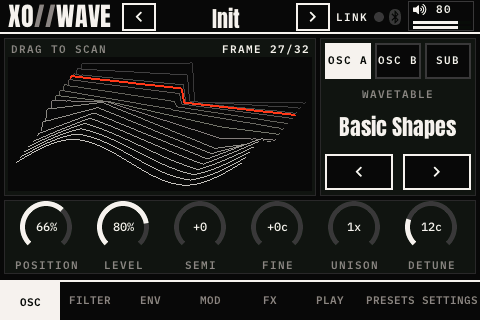
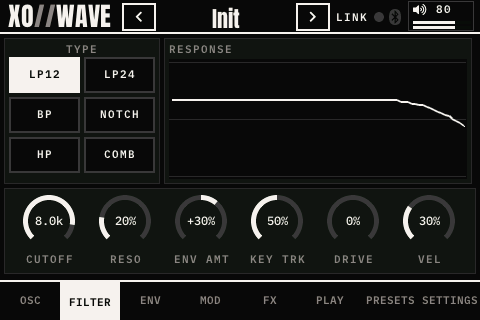
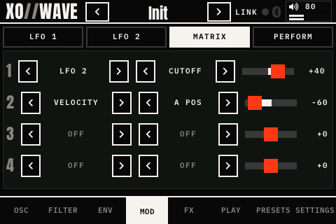
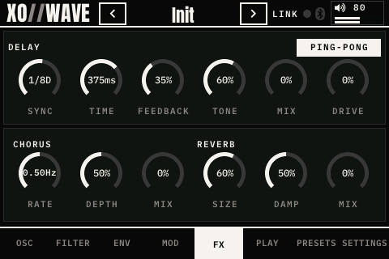
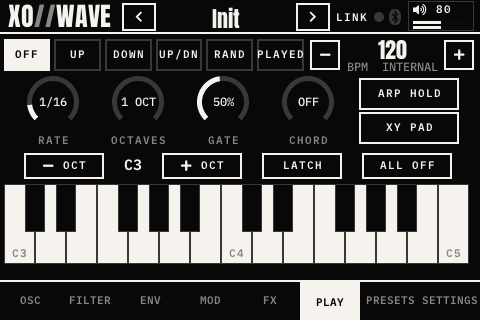
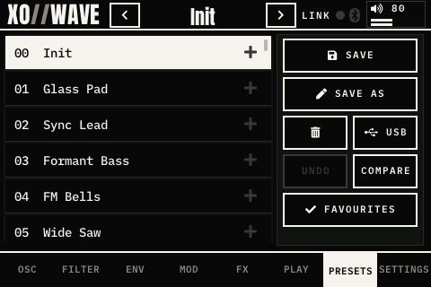
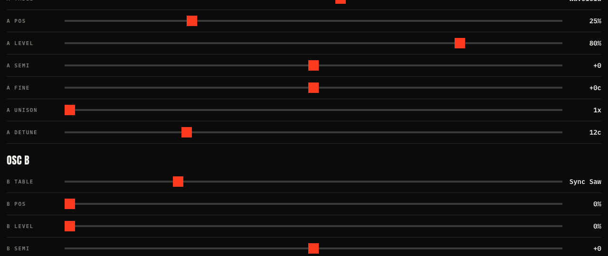
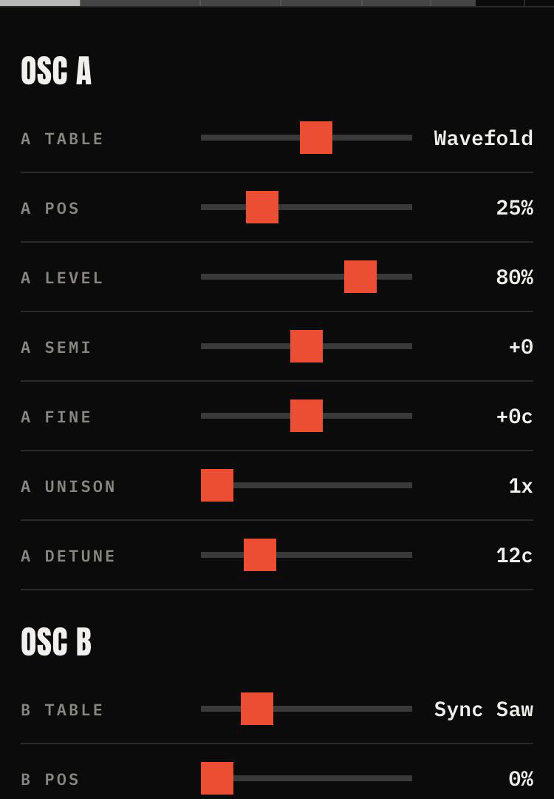

# XO-Wave — standalone wavetable synth for Raspberry Pi 3

Boots straight into an 8-voice (up to 16) stereo wavetable synth. No screen, no desktop.

- **Audio out:** 3.5 mm jack (low latency, ~8 ms) **and** a Bluetooth speaker/headphones at the same time
- **MIDI in:** USB MIDI controllers and **Bluetooth (BLE) MIDI** controllers, auto-connected, hot-pluggable
- 2 wavetable oscillators per voice with up to 4× unison, stereo spread, multimode filter, 2 envelopes, LFO, glide
- 10 built-in wavetables. You can add your own Serum-style `.wav` wavetables
- 96 factory presets, switched on the screen, from the web app or with MIDI program change
- **Touchscreen UI** on a 3.5" SPI TFT (480×320, ILI9486 + ADS7846 touch) in the XOXO//AUDIO//LABS look

| | |
|---|---|
|  |  |
|  |  |
|  |  |

Every page is in [`docs/screenshots/`](docs/screenshots/) (rendered with `--ui-snapshot`). What has and hasn't been tested on hardware is in [TESTING.md](TESTING.md).

## Hardware

- Raspberry Pi 3 Model B (v1.2), 5 V / 2.5 A supply, 8 GB+ microSD
- Headphones or powered speakers on the 3.5 mm jack
- USB MIDI keyboard and/or a BLE MIDI controller (e.g. Korg microKEY Air, CME, ROLI)
- Optional Bluetooth speaker

## 1. Flash the SD card

1. Install **Raspberry Pi Imager** on your computer.
2. Choose **Raspberry Pi 3** → **Raspberry Pi OS Lite (64-bit)**.
3. Click **Edit settings**:
   - Hostname: `xowave` (if you already set `xo4`, use `xo4.local` in the commands below)
   - Username/password: your choice, e.g. `pi`
   - Wi-Fi: your network (needed for setup; you can turn it off later)
   - Services tab: **Enable SSH** → password auth, or paste your public key (`cat ~/.ssh/id_ed25519.pub`)
4. Write the card, put it in the Pi, power on, wait ~2 minutes.

## 2. Get XO-Wave onto the Pi and install

```bash
ssh pi@xowave.local
```

On the Pi:

```bash
sudo apt install -y git && git clone https://github.com/xoxoaudiolabs/XO-WAVE.git ~/xowave
```

```bash
cd ~/xowave && sudo ./install/setup.sh
```

```bash
sudo reboot
```

After the reboot, XO-Wave starts by itself. Plug in a USB keyboard and play. Logs: `journalctl -u xowave -f`.

## 3. Bluetooth

```bash
sudo xowave-bt scan
```

Put the device in pairing mode before scanning. Then pair it using the MAC address from the list:

```bash
sudo xowave-bt pair AA:BB:CC:DD:EE:FF audio
```

```bash
sudo xowave-bt pair 11:22:33:44:55:66 midi
```

`xowave-bt status` shows what's paired. A background service reconnects these devices whenever you switch them back on.

**Bluetooth audio** plays alongside the 3.5 mm jack. The jack is the timing master, so a Bluetooth dropout never glitches the jack. Bluetooth itself adds about 150–250 ms of delay, so it's good for listening or for an audience speaker, but play from the jack or headphones. If it stutters, raise `bluetooth.latency_ms` in `/etc/xowave.conf`.

**Pi 3 radio tip:** the Pi 3 shares a single radio between Wi-Fi and Bluetooth. If Bluetooth audio crackles, install with `sudo ./install/setup.sh --no-wifi`, or add a USB Bluetooth dongle. Without Wi-Fi you'll need Ethernet or a keyboard to get back in.

**Bluetooth MIDI** uses BlueZ's built-in BLE MIDI support: the controller appears as a normal MIDI port and XO-Wave connects to it automatically. If `xowave-bt pair … midi` says no port appeared, check `aconnect -l`. If no port ever shows up, your BlueZ was built without MIDI support (`--enable-midi`).
At the moment the Pi connects *to* BLE MIDI controllers. Letting a phone or iPad connect *to the Pi* as a Bluetooth MIDI device needs an extra BLE MIDI server; that isn't built yet.

## Touchscreen

Tabs along the bottom:

| Tab | What's there |
|---|---|
| **OSC** | 3D wavetable view (the frame being played is drawn in signal red and follows modulation live). Drag on it to scan the table. OSC A / OSC B switch, wavetable picker, position, level, semi, fine, unison, detune |
| **FILTER** | Six types: low-pass 12 dB, low-pass 24 dB (ladder), band, notch, high, comb (tuned by the cutoff); live response curve, cutoff, resonance, envelope amount, key tracking, drive, velocity |
| **ENV** | Amp and mod envelopes with shape previews |
| **MOD** | Four views: **LFO 1** (shape, rate free or synced, destinations), **LFO 2**, **MATRIX** (4 slots: LFO 1/2, mod env, amp env, velocity, mod wheel, aftertouch, key, per-note random → osc A/B position, cutoff, resonance, pitch, osc A/B level, drive, with amounts ±100%) and **PERFORM**: mod-env → position, velocity, glide, bend range, stereo spread, volume |
| **FX** | Delay (free or synced to the tempo: 1/32 to 4 bars, triplets and dotted; feedback, tone, ping-pong), chorus, reverb (size, damping) and a bus drive before them |
| **PLAY** | **XY PAD** (full screen: drag one finger to play two parameters at once; pick X and Y from 20, remembered), arpeggiator (up, down, up/down, random, as played; rate, octaves, gate, hold), chord memory (maj, min, 7, maj7, min7, sus4, 5th, oct), tempo, and a two-octave keyboard with octave shift, latch and all notes off |
| **PRESETS** | Load, save, save as (on-screen keyboard), delete, USB import/backup, **UNDO** (each settled edit is a step; 40 deep), **COMPARE** (flip between your edits and the saved preset), favourites (tap + on a preset; FAVOURITES shows only those) |
| **SETTINGS** | MIDI (channel, MIDI learn, connected inputs) · Bluetooth (scan & pair, forget, latency) · Audio (buffer, polyphony) · Display (touch calibration, knob speed) · System (status, restart, reboot, shut down) |

Knobs: touch a knob and drag **up or right** to turn it up. The top bar shows the preset (◀ ▶ to step), MIDI activity, Bluetooth status, voice count and output level.

The screen calibrates itself the first time XO-Wave starts: tap the four targets. You can redo this in **SETTINGS → DISPLAY**. Settings changed on the screen are saved to `/var/lib/xowave/state.conf`.

The UI uses [LVGL](https://lvgl.io) (MIT), with the **Anton** and **IBM Plex Mono** fonts (SIL Open Font License, see `fonts/`).

## Web app (phone or computer)

 

Open **http://xo-wave.local** on anything on the same network (or the cable): every parameter grouped like the touchscreen pages, presets (◀ ▶ and a list), master volume, tempo and a one-octave keyboard, in the XOXO look. Changes show on the touchscreen too, and the page follows changes made on XO-Wave. It's plain HTTP with no password, like XOXO Studio's web page: anyone on the network can use it. Turn it off with `web.enabled = off`.

## Tempo and MIDI clock

XO-Wave follows MIDI clock from a linked Studio (timed by the Studio's own timestamps, so it locks to the exact tempo) or a USB device, including start/stop; the synced delay, LFO and arpeggiator follow it. With no clock coming in, it runs on its own tempo, set on the PLAY page and remembered.

## Linking to XOXO Studio (Ethernet)

Plug a cable straight from XO-Wave's Ethernet port into a [XOXO Studio](https://github.com/xoxoaudiolabs/XOXO-Studio), or put both on the same network. XO-Wave finds the Studio by itself (mDNS), the same way a Pocket links:

- **MIDI both ways:** XO-Wave joins the Studio's network MIDI as `XO-Wave on <host>` and shows as **NET** in the Studio's MIDI routes. The Studio's keyboards, XO-4 and routes can play XO-Wave, and what you play on XO-Wave (its USB keyboard, KEYS page) goes to the Studio.
- **Sound to the Studio:** XO-Wave streams its output as RTP (L16, 48 kHz stereo, 310-frame packets) to the Studio's UDP 46030, where it's a mixer channel, **XO-WAVE**, that you can hear, record and send to the Studio's speaker. While that's on, the Studio is the audio out: XO-Wave's 3.5 mm jack stays on as a headphone monitor and its Bluetooth speaker pauses (the Studio owns the speaker).
- **The Studio's mix back:** a Studio that supports it sends its mix *less XO-WAVE* (a mix-minus, so you never hear yourself late) to XO-Wave's UDP 46016; XO-Wave plays it on its jack only, under **SETTINGS → STUDIO → STUDIO MIX** (0–100%, remembered). So headphones on XO-Wave hear the whole Studio.
- **Recording and presets from the Studio:** the Studio's REC already records XO-WAVE as its own channel (with Record parts on, its own file), and a program change sent to NET from the Studio's MIDI routes picks an XO-Wave preset.
- **Older Studios:** a Studio without XO-Wave support (before [XOXO-Studio#1](https://github.com/xoxoaudiolabs/XOXO-Studio/pull/1)) links for MIDI only; XO-Wave then keeps playing through its own jack and speaker. It checks the Studio's `/api/status` every 30 s, so updating the Studio switches the sound over without a restart.
- On a bare cable both boxes give themselves a link-local address (169.254.x.x); the installer sets that up (`/etc/NetworkManager/conf.d/50-xowave-ethernet-link.conf`).
- Turn the link on or off in **SETTINGS → STUDIO**; **LINK** lights in the top bar while linked. In `/etc/xowave.conf`: `link.enabled`, `link.studio` (`auto` or an address), `link.port`.

Tested: the session, MIDI both ways and the audio packets against XOXO Studio's own `netmidi.py` (`tests/link_test.cpp` + `tests/fake_studio.py`), and a MIDI-only link to a real Studio on Wi-Fi. Not yet tried: sound into an updated Studio's XO-WAVE channel, a direct cable.

## Controls (default MIDI CC map)

| CC | Parameter | CC | Parameter |
|---|---|---|---|
| 1 | Mod wheel → vibrato | 64 | Sustain pedal |
| 74 | Filter cutoff | 71 | Resonance |
| 73 | Amp attack | 72 | Amp release |
| 20 | Osc A wavetable position | 21 | Osc B wavetable position |
| 22 | Osc A wavetable select | 23 | Osc B wavetable select |
| 24 | LFO rate | 25 | LFO → position |
| 26 | Filter envelope amount | 27 | Mod env → position |
| 7 | Volume | 5 | Glide |

Change these in `/etc/xowave.conf` (`cc.<number> = <parameter>`). `xowave --list-params` lists every parameter. Program change 0–95 selects a preset (numbers past the last preset wrap around).

## Presets and wavetables

- Presets are text files in `/opt/xowave/presets/*.xowave`, one `parameter = value` per line. Wavetables can be given by name, e.g. `a_table = Formant`. Copy one, edit it, then run `sudo systemctl restart xowave`.
- **From a USB stick:** plug it in and open **PRESETS → USB**. It lists the Serum-style wavetables (`.wav`) and XO-Wave presets (`.xowave`) on the stick (up to 3 folders deep). IMPORT copies one in, IMPORT ALL copies the lot; imported presets appear at once, imported wavetables after a RESTART (the button shows up). BACK UP PRESETS writes every preset to `XO-WAVE/presets` on the stick. FAT32 and exFAT sticks are mounted automatically.
- Or copy Serum-style wavetable `.wav` files (2048 samples per frame) into `/opt/xowave/wavetables/` yourself. They're added after the 10 built-in tables. `xowave -c /etc/xowave.conf --list-tables` shows their numbers.

The OSC page's **SUB** view has a sub oscillator (sine or square, one or two octaves down) and noise.

Built-in tables: Basic Shapes (sine→tri→saw→square), PWM, Sync Saw, Formant, FM, Wavefold, Organ, Digital, Harmonic Sweep, Grit.

## Updates

**SETTINGS → SYSTEM → UPDATE** checks [xoxoaudiolabs/XO-WAVE](https://github.com/xoxoaudiolabs/XO-WAVE) for a newer version; **INSTALL** fetches it, builds and tests it on the Pi, installs it and restarts XO-Wave (a few minutes). If the build or tests fail nothing changes, and if the new version won't start the old one is put back. Your settings, presets and session are kept. Updates come over plain HTTPS from the public repo, so no GitHub account or key is needed, just an internet connection.

From a terminal: `sudo xowave-update check` / `sudo xowave-update install`; progress is in `/var/lib/xowave/update.log`.

## Troubleshooting

| Problem | Fix |
|---|---|
| No sound from jack | `xowave --list-devices`, then set `audio.device` (older images call the jack `CARD=ALSA`). Check the volume: `alsamixer` |
| Clicks / "xruns" in log | `audio.period = 256` in `/etc/xowave.conf`, or lower `synth.voices` |
| CPU headroom | `xowave -c /etc/xowave.conf --bench` (worst case: all voices, 4× unison on both oscs) |
| A note drops out when playing very dense, heavy patches | That's the **CPU guard**: when a period gets close to its deadline it fades the oldest/quietest voice out instead of letting the audio break up, and gives voices back after 2 s of calm. SETTINGS → SYSTEM shows "CPU: MAX n" while it's limiting. `synth.cpu_guard = off` turns it off |
| Keyboard not responding | `aconnect -l` should show XO-Wave connected; check `midi.channel` |

## Developing on the Mac

`make` builds an offline version (no audio hardware needed):

```bash
make && ./xowave -c xowave.conf --render demo.wav
```

```bash
make test
```

`--render` plays a chord through each preset and writes a WAV file. `make test` checks aliasing, stability at extreme settings and voice stealing. Use `--bench` to measure CPU.

`./xowave -c xowave.conf --ui-snapshot DIR` renders every touchscreen page to PNG files, with no display needed.

Stress tests (add `SAN=1` for the address + undefined-behaviour sanitizers; AddressSanitizer doesn't run on the Pi 3's kernel, use `-fsanitize=undefined` there):

```bash
make stress SECONDS=120
```

```bash
make filefuzz SAN=1
```

```bash
make netfuzz SAN=1
```

`stress` throws random MIDI storms, parameter changes (including out-of-range ones), presets, arpeggiator/chord/hold/sustain toggling and MIDI clock at the engine and checks the output stays finite and bounded, notes always end, and periods stay on time. `filefuzz` feeds hostile WAVs and preset/settings files; `netfuzz` hostile HTTP requests and random Studio-link packets.

Code layout: `src/ui/` (touchscreen UI), `src/engine_link.h` (lock-free UI ↔ audio link), `src/synth.*` (voices and modulation), `src/wavetable.*` (band-limited mipmapped tables), `src/dsp.h` (filter and envelopes), `src/alsa_io.*` (audio and MIDI), `src/bt_output.*` (Bluetooth output), `install/` (Pi setup and services).

## License

XO-Wave is free software under the [GNU General Public License v3.0](LICENSE), the same as XOXO Studio. Bundled third-party code keeps its own license: [LVGL](third_party/lvgl/LICENCE.txt) (MIT) and the Anton and IBM Plex Mono fonts (SIL Open Font License, [`fonts/`](fonts/)).
